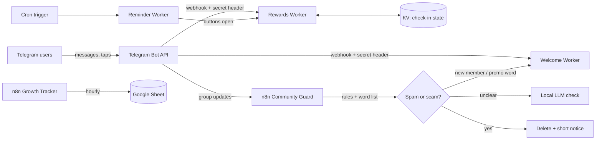

# Telegram community automation

I designed, built and run the Telegram side of a consumer brand's community in the Philippines (brand name withheld). It is three bots on Cloudflare Workers, a moderation and growth layer in n8n, and a local AI model for safety checks. I worked with AI coding agents: I set the rules, approved every player-facing text, and checked each release before it went live.

## What it does

| Part | Job | Built with |
|---|---|---|
| **Rewards bot** | Promo menu with banners and link buttons, 7-day daily check-in card, invite flow | Cloudflare Worker, KV storage, Telegram webhooks |
| **Welcome bot** | Greets new members with the channel card and a Play button; replies to promo questions in the group | Cloudflare Worker |
| **Reminder bot** | Short scheduled reminders that open the Rewards bot | Cloudflare Worker, cron triggers |
| **Community Guard** | Deletes spam, links, scam bait, fake admin names and OTP requests in the group chat | n8n workflow, word list, local LLM check |
| **Growth Tracker** | Records the public channel's member count every hour | n8n schedule, Google Sheets |
| **Reply assistant** | Drafts replies to my own work chats in my writing style, with hard safety rules | n8n, LM Studio (local model) |

## How it fits together

## Design choices
- **Webhooks, not polling.** Each Worker answers only Telegram calls that carry the right secret header. Anything else gets `403`.
- **Secrets never in code.** Bot tokens and secret words live in Cloudflare Secrets and n8n credentials.
- **Delete, never ban.** The Guard removes the message and posts a 60-second notice. It never mutes or bans, so a false positive costs little.
- **Rules first, AI second.** A whole-word list catches the clear cases fast. Only unclear messages go to the local model, with a timeout. If the model is slow or unsure on a message that has a scam cue, the safe default applies.
- **Admins are exempt automatically**, so the team is never moderated by its own bot.
- **Rate limits on replies.** One promo reply per member per 6 hours and one per group per 2 minutes, never to admins or bots.
- **Check-in rules.** One check-in per Philippine calendar day. Missing a day resets the streak. The bot records only; rewards are paid by the team after their checks.
- **Free-tier aware.** KV has a daily write limit, so each user action costs at most one write.

## Results I can share
- Guard test set: **41 of 41** scam messages deleted, **0 of 37** normal messages deleted.
- Live tests passed for delete + notice, promo reply with button, and the welcome on leave/rejoin.
- All three bots moved from a private test to public in one week, with every player text approved before launch.

## Code in this repo
`reference-bot/` is a small, clean version of the check-in bot that I wrote for this portfolio. It shows the same patterns (secret header, KV state, Philippine date, inline buttons). The production bots, their texts and data stay private.
